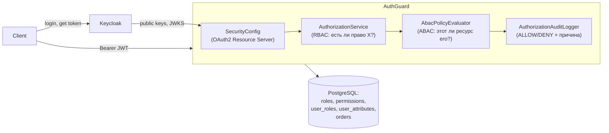

# AuthGuard

Централизованный сервис авторизации — учебный проект и элемент портфолио для позиций
Java-разработчика. Keycloak (OIDC) отвечает за **аутентификацию** — кто ты, и выдаёт JWT;
AuthGuard отвечает за **авторизацию** — что тебе разрешено, через собственную модель
RBAC + ABAC. Это два принципиально разных вопроса, и проект рассматривает их как два
отдельных, тестируемых слоя, а не как одну проверку "токен валиден — значит можно".

## Архитектура



Keycloak никогда не хранит роли и права AuthGuard — это была бы вторая система учёта,
которая могла бы разойтись с первой. Вся эта модель целиком принадлежит AuthGuard, привязана
к `sub`-claim JWT от Keycloak.

## Стек технологий

Java 21, Spring Boot 3.5.16, Spring Security (OAuth2 Resource Server), Spring Data JPA,
PostgreSQL 16, Flyway, Keycloak 26.7 (dev-режим), springdoc-openapi, JUnit 5 + Mockito +
AssertJ, Testcontainers, Docker Compose, GitHub Actions.

## Структура проекта

| Пакет | За что отвечает |
|---|---|
| `controller` | REST-эндпоинты. Тонкий слой: достаёт идентичность вызывающего из JWT, делегирует сервису, возвращает DTO. |
| `dto` | Формы запросов/ответов — JPA-сущности никогда не возвращаются напрямую. |
| `service` | Бизнес-логика. Вызывает `AuthorizationService` **до** обращения к данным, а не только надеется на контроллер. |
| `authorization` | RBAC (`AuthorizationService`) и ABAC (`AttributeProvider`, `AbacPolicyEvaluator`, `AbacContext`) — вычисление решений. |
| `security` | Конфигурация Spring Security: превращает сервис в OAuth2 Resource Server. |
| `audit` | Структурированное логирование ALLOW/DENY для каждого решения авторизации. |
| `entity` / `repository` | JPA-модель и доступ к данным. |
| `exception` | Кастомные исключения + единый формат ответа об ошибке. |
| `config` | Сквозная конфигурация (OpenAPI). |

## Запуск локально

Требуется: JDK 21, Maven 3.9+, Docker Desktop.

```bash
docker compose up -d        # PostgreSQL + Keycloak (realm импортируется автоматически)
mvn spring-boot:run
curl http://localhost:8080/actuator/health   # {"status":"UP"}
```

Админ-консоль Keycloak: http://localhost:8081 (`admin` / `admin`). Подробности настройки,
включая то, как заведены два тестовых пользователя (`alice` = ADMIN, `bob` = MANAGER),
описаны в [docs/keycloak-setup.md](docs/keycloak-setup.md).

Документация API: http://localhost:8080/swagger-ui/index.html (оставлена открытой — за ней
нет данных).

## Запуск тестов

```bash
mvn clean verify
```

Запускает unit-тесты (Mockito), slice-тесты Spring MVC (`@WebMvcTest` + замоканный
`JwtDecoder`, без обращений по сети) и интеграционные тесты на **настоящем** PostgreSQL
через Testcontainers (не H2) — они реально прогоняют Flyway-миграции и проверяют
засеянные данные RBAC/ABAC. Требуется запущенный Docker.

## Пробуем целиком

```bash
# 1. Получаем токен (password grant — нормально для этого dev-клиента, но не то,
#    как получал бы токен настоящий фронтенд)
TOKEN=$(curl -s -X POST "http://localhost:8081/realms/authguard/protocol/openid-connect/token" \
  -d "client_id=authguard-api" -d "grant_type=password" -d "username=bob" -d "password=bob123" \
  | jq -r .access_token)

# 2. Кто я?
curl -s http://localhost:8080/api/v1/me -H "Authorization: Bearer $TOKEN"

# 3. RBAC: bob (MANAGER) не может управлять ролями -> 403
curl -i http://localhost:8080/api/v1/roles -H "Authorization: Bearer $TOKEN"

# 4. ABAC: bob видит заказ в своём регионе...
curl -s http://localhost:8080/api/v1/orders/1 -H "Authorization: Bearer $TOKEN"
# ...и свой собственный заказ даже вне своего региона...
curl -s http://localhost:8080/api/v1/orders/2 -H "Authorization: Bearer $TOKEN"
# ...но не чужой заказ в другом регионе -> 403
curl -i http://localhost:8080/api/v1/orders/3 -H "Authorization: Bearer $TOKEN"
```

Каждое из этих решений записывается `AuthorizationAuditLogger` в лог приложения как
структурированная строка `AUTHORIZATION_AUDIT`: кто, какое действие, какой ресурс,
ALLOW или DENY, и почему — никогда пароль, токен или другой секрет.

## Модель авторизации

- **RBAC**: таблицы `roles`, `permissions`, `role_permissions`, `user_roles` живут в
  собственной схеме PostgreSQL AuthGuard, а не в Keycloak. `AuthorizationService.requirePermission(...)` —
  единая точка принятия решения с отказом по умолчанию (fail-closed), которую вызывает
  каждый сервис перед обращением к данным.
- **ABAC**: накладывается на RBAC для отдельных ресурсов (продемонстрировано на `orders`).
  `AttributeProvider` (откуда берутся атрибуты) отделён от `AbacPolicyEvaluator` (что с ними
  делать) — небольшой фиксированный набор именованных правил (`SAME_REGION`, `RESOURCE_OWNER`),
  никогда не хранимый/`eval`'imый язык политик. Неизвестное имя правила или отсутствующий
  атрибут всегда приводят к отказу, никогда — к разрешению.

## Безопасность: что проверено, а что осознанно не покрыто

Проверено — и автоматическими тестами, и вручную на настоящем Keycloak:

- `401` без токена/с невалидным токеном, `403` с валидным токеном без нужного права или
  доступа к ресурсу — они явно различаются.
- Подпись/срок действия/issuer JWT проверяются Spring Security по ключам самого Keycloak
  (никакого собственного кода выпуска токенов).
- Одного права недостаточно для доступа к произвольному ресурсу (IDOR) — ABAC проверяет
  конкретный ресурс.
- Неизвестные имена ABAC-правил и отсутствующие атрибуты приводят к отказу.
- Ни секретов, ни паролей, ни "сырых" JWT — ни в логах, ни в репозитории.

Осознанно не входит в этот MVP (ограничения, а не недочёты):

- Нет эндпоинта для изменения ролей существующего пользователя — для демонстрации они
  заведены через миграцию.
- Password grant используется только для получения тестовых токенов из терминала;
  настоящий клиент использовал бы Authorization Code flow.
- Swagger UI и Keycloak работают без TLS/хардненинга — нормально для локальной разработки,
  но не для продакшена в таком виде.
- Нет rate limiting, нет обработки refresh-токенов, нет мультитенантности.
