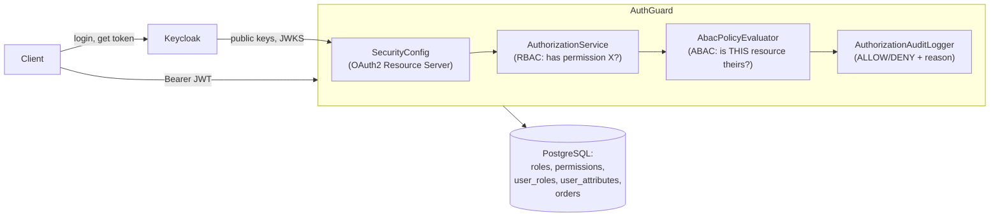

# AuthGuard

A centralized authorization service, built as a learning project and portfolio piece
for Java backend roles. Keycloak (OIDC) handles **authentication** — who you are, and
issues the JWT; AuthGuard handles **authorization** — what you're allowed to do, through
its own RBAC + ABAC model. The two are never the same question, and this project treats
them as two separate, testable layers rather than one "has a valid token" check.

## Architecture



Keycloak never stores AuthGuard's roles or permissions — that would be two systems
of record that could drift apart. AuthGuard owns that model entirely, keyed by the
Keycloak JWT's `sub` claim.

## Tech stack

Java 21, Spring Boot 3.5.16, Spring Security (OAuth2 Resource Server), Spring Data JPA,
PostgreSQL 16, Flyway, Keycloak 26.7 (dev mode), springdoc-openapi, JUnit 5 + Mockito +
AssertJ, Testcontainers, Docker Compose, GitHub Actions.

## Project layout

| Package | Responsibility |
|---|---|
| `controller` | REST endpoints. Thin: extract the caller's identity from the JWT, delegate to a service, return a DTO. |
| `dto` | Request/response shapes — JPA entities are never returned directly. |
| `service` | Business logic. Calls `AuthorizationService` *before* touching data, not just relying on the controller layer. |
| `authorization` | RBAC (`AuthorizationService`) and ABAC (`AttributeProvider`, `AbacPolicyEvaluator`, `AbacContext`) decision-making. |
| `security` | Spring Security wiring: turns this service into an OAuth2 Resource Server. |
| `audit` | Structured ALLOW/DENY logging for every authorization decision. |
| `entity` / `repository` | JPA model and data access. |
| `exception` | Custom exceptions + one shared error response shape. |
| `config` | Cross-cutting config (OpenAPI). |

## Running locally

Prerequisites: JDK 21, Maven 3.9+, Docker Desktop.

```bash
docker compose up -d        # PostgreSQL + Keycloak (realm auto-imported)
mvn spring-boot:run
curl http://localhost:8080/actuator/health   # {"status":"UP"}
```

Keycloak admin console: http://localhost:8081 (`admin` / `admin`). Full setup details,
including how the two test users (`alice` = ADMIN, `bob` = MANAGER) are provisioned, are
in [docs/keycloak-setup.md](docs/keycloak-setup.md).

API docs: http://localhost:8080/swagger-ui/index.html (left open — no data behind it).

## Running tests

```bash
mvn clean verify
```

Runs unit tests (Mockito), Spring MVC slice tests (`@WebMvcTest` + a mocked `JwtDecoder`,
so no network calls), and integration tests against a **real** PostgreSQL via
Testcontainers (not H2) — these actually run the Flyway migrations and verify the seeded
RBAC/ABAC data. Needs Docker running.

## Trying it end to end

```bash
# 1. Get a token (password grant — fine for this dev client, not how a real frontend would do it)
TOKEN=$(curl -s -X POST "http://localhost:8081/realms/authguard/protocol/openid-connect/token" \
  -d "client_id=authguard-api" -d "grant_type=password" -d "username=bob" -d "password=bob123" \
  | jq -r .access_token)

# 2. Who am I?
curl -s http://localhost:8080/api/v1/me -H "Authorization: Bearer $TOKEN"

# 3. RBAC: bob (MANAGER) is not allowed to manage roles -> 403
curl -i http://localhost:8080/api/v1/roles -H "Authorization: Bearer $TOKEN"

# 4. ABAC: bob can see an order in his own region ...
curl -s http://localhost:8080/api/v1/orders/1 -H "Authorization: Bearer $TOKEN"
# ... and his own order even outside his region ...
curl -s http://localhost:8080/api/v1/orders/2 -H "Authorization: Bearer $TOKEN"
# ... but not someone else's order in a different region -> 403
curl -i http://localhost:8080/api/v1/orders/3 -H "Authorization: Bearer $TOKEN"
```

Every one of these decisions is written to the application log by
`AuthorizationAuditLogger` as a structured `AUTHORIZATION_AUDIT` line: who, what action,
which resource, ALLOW or DENY, and why — never a password, token, or secret.

## Authorization model

- **RBAC**: `roles`, `permissions`, `role_permissions`, `user_roles` live in AuthGuard's
  own PostgreSQL schema, not in Keycloak. `AuthorizationService.requirePermission(...)` is
  the single fail-closed decision point every service calls before touching data.
- **ABAC**: layered on top of RBAC for individual resources (demonstrated on `orders`).
  `AttributeProvider` (where attributes come from) is kept separate from
  `AbacPolicyEvaluator` (what to do with them) — a small, fixed set of named rules
  (`SAME_REGION`, `RESOURCE_OWNER`), never a stored/`eval`'d policy language. An unknown
  rule name or a missing attribute always resolves to deny, never to allow.

## Security: what's verified vs. what's out of scope

Verified, with both automated tests and manual checks against a real Keycloak:

- 401 with no/invalid token, 403 with a valid token lacking the right permission or
  resource access, distinguished from each other.
- JWT signature/expiry/issuer validated by Spring Security against Keycloak's own keys
  (no custom token-issuing code).
- A permission alone does not grant access to an arbitrary resource id (IDOR) — ABAC
  checks the specific resource.
- Unknown ABAC rule names and missing attributes fail closed.
- No secrets, passwords, or raw JWTs in logs or in the repository.

Explicitly out of scope for this MVP (known limitations, not oversights):

- No endpoint to change an existing user's roles — seeded via migration for the demo.
- Password grant is used only to fetch test tokens from a terminal; a real client would
  use the Authorization Code flow.
- Swagger UI and Keycloak run without TLS/hardening — fine for local dev, not for
  production as configured here.
- No rate limiting, no refresh-token handling, no multi-tenancy.
